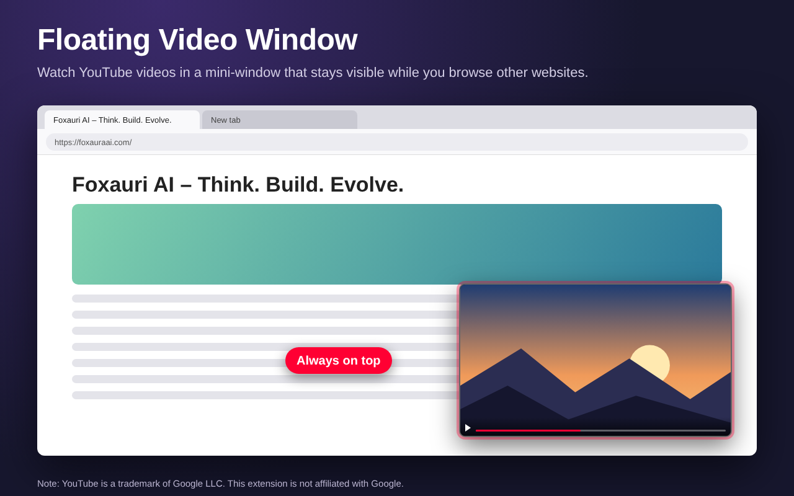
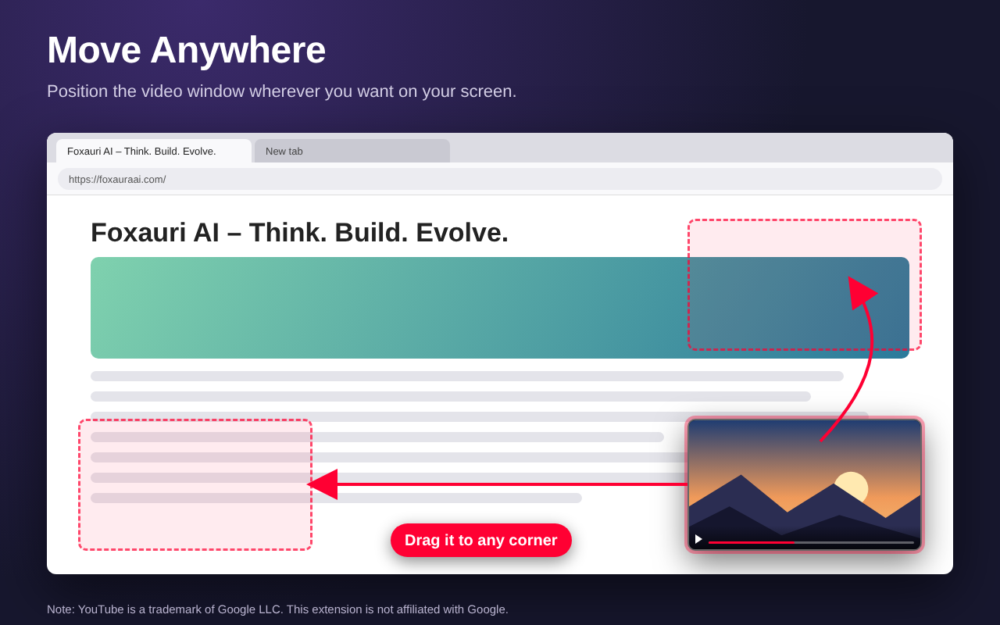
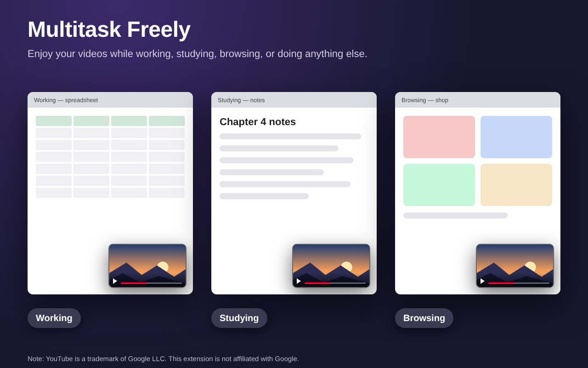
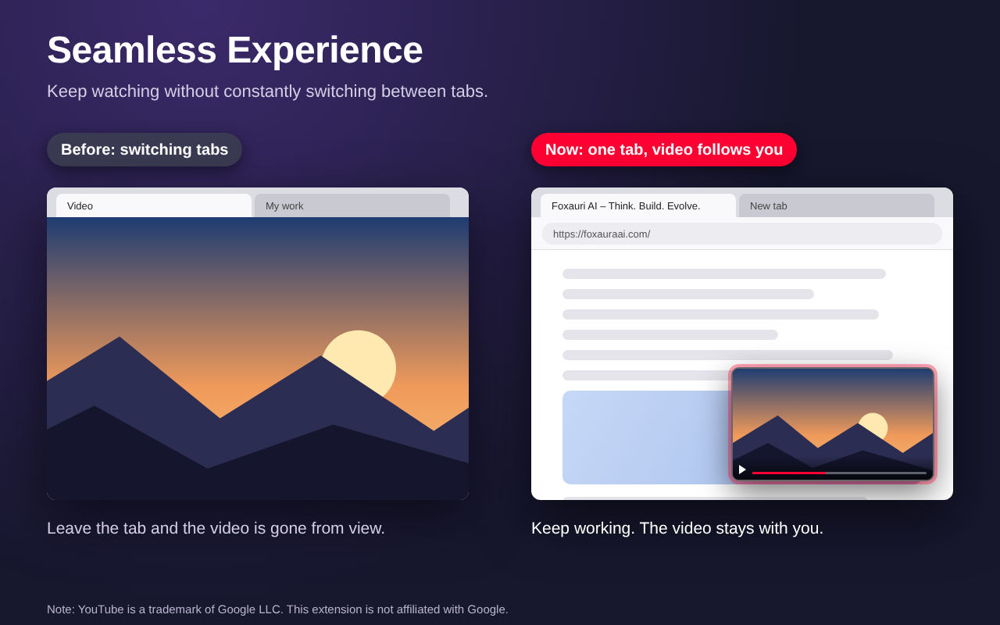

# YouTube All Around – Watch YouTube Anywhere

> Enjoy YouTube without interrupting your workflow!
> 
> YouTube All Around, developed by Foxaura AI, lets you watch YouTube videos in a convenient floating mini-window while browsing other websites, working, studying, or doing anything else.
> 
> No more switching between tabs just to check your video. Keep your favorite content visible and enjoy a more flexible multitasking experience.

[](./LICENSE)
[](https://addons.mozilla.org/en-US/firefox/addon/youtube-all-around/)
[](https://foxauraai.com)

---

## ✨ Features

- 🪟 **Floating Video Window** — watch YouTube videos in a separate Picture-in-Picture window while browsing other websites.
- 🖱️ **Move Anywhere** — drag the floating window and position it wherever you want on your screen.
- 📐 **Resizable Window** — adjust the video window size to match your preferences.
- 🔄 **Seamless Multitasking** — continue watching videos while switching between tabs and working on other tasks.
- 🎛️ **Playback Controls** — access video controls through the extension popup.
- 🔊 **Volume Control** — adjust video volume without returning to the original YouTube tab.
- 🎞️ **Video Quality** — change playback quality from the control panel.
- ⚡ **Playback Speed** — control video playback speed.
- 💬 **Captions & Subtitles** — manage captions directly through the extension controls.
- 🎯 **Quick Activation** — activate Picture-in-Picture using the button displayed when hovering over a YouTube video.

---

## 📸 Screenshots

<p align="center">
  
  
</p>

<p align="center">
  
  
</p>

---

## 🚀 Installation

### From Source

1. Clone this repository:

   ```bash
   git clone https://github.com/foxauraai/youtube-all-around.git
   ```

2. Open Firefox and navigate to `about:debugging`
3. Click **This Firefox** → **Load Temporary Add-on**
4. Select the `manifest.json` file from the cloned folder
   > Requires Firefox 142.0 or newer.
5. Open YouTube and start watching a video.
6. Hover over the video and click the Picture-in-Picture button.

---

## 🗂️ Project Structure

```text
youtube-all-around/
├── icons/
│   └── Extension icons
├── screenshots/
├── background.js       # Background scripts and extension events
├── content.js          # YouTube integration and floating video controls
├── manifest.json       # Extension configuration and permissions
├── popup.html          # Extension popup interface
├── popup.js            # Popup controls and playback settings
└── README.md
```

---

## ⚙️ How It Works

| Capability | Description |
|---|---|
| Video Detection | Detect YouTube videos and display a Picture-in-Picture activation button. |
| Floating Window | Open the video in a separate floating window. |
| Window Position | Drag the floating video window to any preferred screen position. |
| Window Resizing | Adjust the floating window dimensions. |
| Playback Controls | Access volume, quality, playback speed, and captions through the extension popup. |
| Multitasking | Continue watching while browsing other tabs and websites. |

---

## 📖 How to Use

1. Open any YouTube video.
2. Hover over the video player.
3. Click the Picture-in-Picture button that appears near the edge of the video.
4. Switch to another browser tab while keeping the original YouTube tab open.
5. Click the extension icon to access the control panel.
6. Adjust volume, video quality, playback speed, or captions.

**Note:** The original YouTube tab must remain open because it provides the video playback source.

---

## 🔒 Privacy

YouTube All Around collects **no data**.

---

## 📄 Credits

**YouTube All Around** is developed with ❤️ by [Foxaura AI](https://foxauraai.com).

“Note: YouTube is a trademark of Google LLC. This extension is not affiliated with Google."